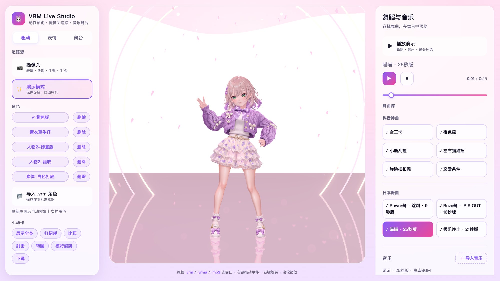
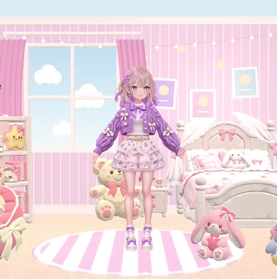
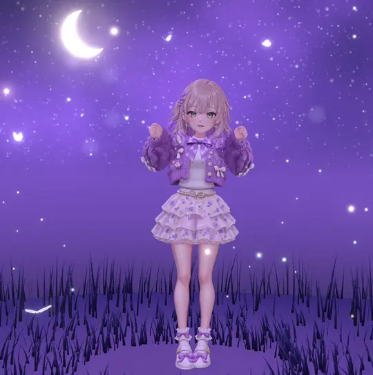
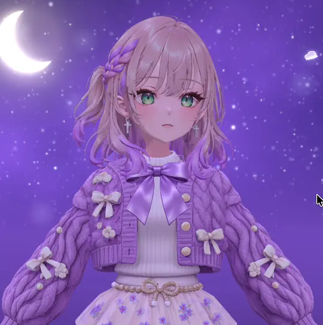
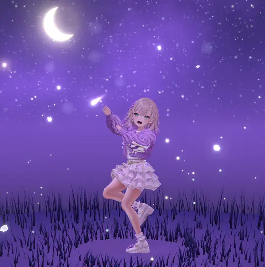

English | [中文](README.zh-CN.md)

# vrm-polish · VRM avatar polish + Director Console

Polishes a basic VRM made with [Charakuru](https://github.com/nanocle/Charakuru) into an avatar ready for streaming and dancing, with a browser console for driving and checking it.

- **Polish skill**: runs after Charakuru's weight step. Exports about 100 VRM expressions (standard expressions, ARKit 52, gaze, anime decals and 6 joint correctives) and adds a mouth interior, skull, neck transition, template hands and clothing colour fixes. Intended for Claude Code and other agents.
- **Director Console** (`studio/`): the webcam drives the face, head, arms and fingers; dances and short motions play on switchable stages. No characters, dances or music are included; see [studio/MEDIA.md](studio/MEDIA.md) for sources and how to add them.

The code is free and open source (MIT); external services have their own costs. This repository contains no Charakuru code and only calls scripts from the user's own Charakuru installation. Get Charakuru from its authors and follow its licence.

By 三三的AI笔记 · [Xiaohongshu](https://www.xiaohongshu.com/user/profile/547f3c02d6e4a9405fe65ea6)

## Demo



<table>
<tr>
<td><br>Switching characters</td>
<td><br>Dancing</td>
</tr>
<tr>
<td><br>Expressions (1.5× speed)</td>
<td><br>Switching stages while dancing</td>
</tr>
</table>

Recorded in the Director Console. The characters shown were polished with this skill and are not included in the repository.

## Division of work with Charakuru

| Stage | Charakuru | This repository |
|---|---|---|
| Images, Tripo candidates, parts and textures, proportions | Does all of it | — |
| Rig | Tripo rigging, bone readback | `rig.sh upload` exports an upload file under 10 MB; `rig.sh check` checks left–right symmetry |
| Weights | Base-body weight transfer | Finishes the step when small wrist accessories make it fail |
| **Handover** | The weight result, `weighted.blend` | Starts here |
| Polish build | — | Skull, neck transition, template hands, colour by clothing piece, physics bones |
| Springs (hair and skirt physics) | Kit scripts set up and audit them | Calls the kit scripts, then adds arm and hand colliders for skirts |
| Expressions and mouth | Standard output has a neutral face and fixed gaze | About 100 expressions, closed mouth bag and tongue, written through the kit's expression integration |
| Joints and proportions | Proportions are set before rigging, then locked | Shoulder, knee and elbow correctives; head proportion can still change after rigging |
| Checking and streaming | Workbench preview | Director Console |

Stage-by-stage notes and pitfalls are in the [Charakuru integration guide](references/en/charakuru-integration.md).

## What it adds to Charakuru

| Area | Charakuru 1.1.1 | With this repository |
|---|---|---|
| Expressions | None in the standard flow; a separate authoring workflow exists | Standard expressions, ARKit 52, gaze and anime decals; mouth-width and natural emotion limits |
| Mouth interior | Its expression skill explicitly does not create mouth interiors, teeth or tongues; opening moves existing lip edges | Existing pockets are tidied on closed heads; face shells get a closed mouth bag. Opening shows depth and a tongue, checked from the front, 45° and the side |
| Head | Depends on the Tripo input: a face shell or a complete head | Skull, neck transition, jaw and brow treatment chosen by structure; head proportion changes after rigging without re-rigging or extra Tripo credits |
| Hands | Generated hands | MakeHuman template hands (CC0) fitted when fingers are fused; wrist band for long sleeves, 4-segment twist for bare forearms |
| Textures | Generated from reference images | Skin colour removed from clothing by piece, stopping at long-sleeve cuffs; belts and accessories recoloured; optional safety shorts |
| Deformation | Base skinning | 6 shoulder, knee and elbow correctives driven by joint angles in the console; layered clothes share torso weights |
| Setup | — | Automatic measurement, a starter head profile, full-profile reuse across outfits, hand-tuned values kept separately |
| Showing | — | Webcam driving, dances and short motions, stages; hand-to-face avoidance based on the real head shape |

The mouth comparison refers to the expression skill in the [Charakuru v1.1.1 release](https://github.com/nanocle/Charakuru/releases/tag/v1.1.1): “口内・歯・舌・テクスチャを新造して欠点を隠しません” (it does not build new mouth interiors, teeth, tongues or textures).

## Usage

```text
Charakuru: images → candidates → parts and textures → proportions
    zsh polish/pipeline/rig.sh upload <project>              upload file for rigging
    zsh polish/pipeline/rig.sh check <returned FBX>           symmetry check
Charakuru: rig → weights
    zsh polish/pipeline/prepare.sh <project> <head profile>   measurements, config, piece sheet
    zsh polish/pipeline/polish.sh <project> <head profile> <out.vrm>
    zsh polish/pipeline/head_ratio.sh <out.vrm>               measure head proportion; adjust and rebuild if needed
Check in the Director Console
```

For a new character use `assets/head-profile/` (the starter head profile). It holds facial landmarks, head settings and anime decals only, with no mesh or texture from any character; a new head is recognised and aligned automatically.

Details: the [skill guide](references/en/skill.md) (agents read [SKILL.md](SKILL.md), in Chinese), plus the [Charakuru integration](references/en/charakuru-integration.md), [troubleshooting](references/en/troubleshooting.md), [configuration](references/en/configuration.md), [head profiles](references/en/head-profiles.md), [head proportions](references/en/head-proportions.md) and [acceptance checklist](references/en/acceptance-checklist.md) guides (also in [Chinese](references/)).

## Head proportions

Choose by style first: realistic 7.5 heads, idealised 8, anime-style 6.5, chibi 3. Men and women use the same scale; measured averages differ by about 0.25 heads. When a man and a woman in the same style appear together, the man can be 0.25–0.5 heads taller. Sources and the adjustment method are in [head proportions](references/en/head-proportions.md).

## Director Console

```text
studio/start-mac.command      macOS: double-click
studio/start-windows.bat      Windows: double-click
```

Requires Python 3 and an internet connection on first launch. Drop your own `.vrm` into the window. Download dances, short motions and music from their authors' pages and add them with `studio/tools/add-media.py`; see [studio/MEDIA.md](studio/MEDIA.md). More in [studio/README.md](studio/README.md).

## Requirements

- Polish pipeline: macOS and zsh; Charakuru 1.1.1 (obtained separately); Blender 5.2 with the VRM Add-on (`BLENDER` overrides the path); Python 3 with numpy and Pillow; Node.js 22.
- Upstream generation of a new character: a Tripo account (about 300 credits per character) and an image-generation tool.
- Director Console: macOS or Windows, Python 3, Chrome or Edge; adding MMD dances also needs Node.js 18+ and ffmpeg.

## Known limits

- New-head recognition targets heads generated by Tripo and supports two structures (separate eye white, iris and lash pieces, or painted together); other structures stop with an error naming what is missing.
- Packing a full head profile currently supports heads with separate eye, brow and crease pieces only.
- Measurement rules come from the existing outfits; check neck, belt and cuff close-ups the first time on a new body.
- Wide long skirts still clip during high kicks and squats.
- Fast hand-to-face movement can leave a few frames of 1–3 mm contact.
- Some facial actions are subtle. Cheek puff moves about 6 mm, mostly outward and often behind the hair, so it is hard to see from the front, and on some heads it is 0. Nose sneer, mouth press and mouth close move about 1 mm. Webcam tracking gives low cheek-puff values and has no tongue-out.
- Webcam tracking: after a hand is lowered out of the picture, the pose model sometimes still places the wrist in front of the chest, and the avatar's hand stays raised partway.
- Webcam arm motion is not fully smooth: the face, hand and pose models take turns, so each runs at about a third of the camera frame rate (about 10 times a second with a 30 fps camera). The frames in between are interpolated, so fast movements can look stepped or lag.

## Licence

- Repository code: MIT.
- `assets/makehuman-hand/`: MakeHuman assets, CC0.
- `studio/scenes/bedroom/items/`, `studio/assets/manpu/`: bedroom props and comic marks made for this project, MIT with the repository.
- `studio/tools/skeleton.json`: bone positions of the VRoid sample model AvatarSample_B, used to convert MMD motions.
- Charakuru is used as an external dependency only; see the [integration guide](references/en/charakuru-integration.md) for the call boundaries.
- Dances, short motions and music are not included; use them under the terms of each source page.

If you stream or post videos with the Director Console, or use this repository in another project, a credit is appreciated: 三三的AI笔记 ([Xiaohongshu](https://www.xiaohongshu.com/user/profile/547f3c02d6e4a9405fe65ea6)).
