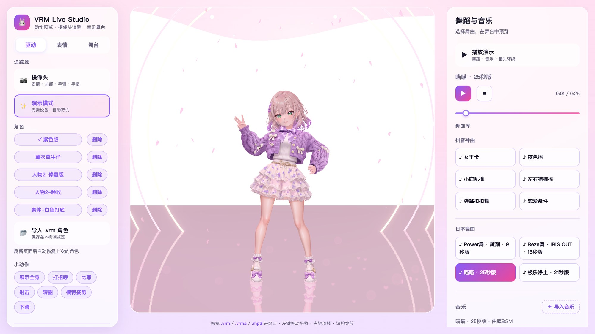
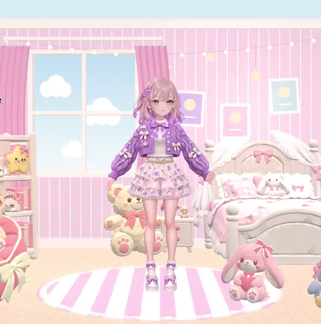
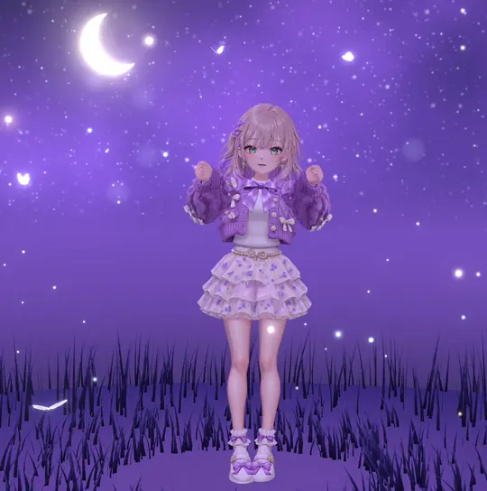
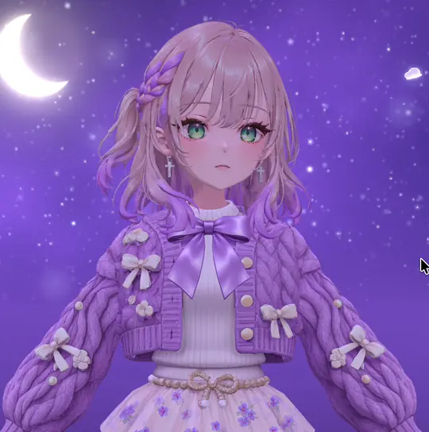
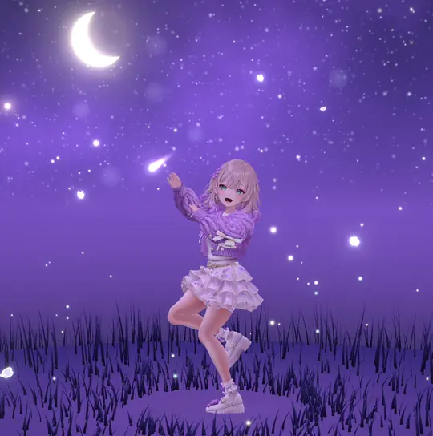

[English](README.md) | 中文

# vrm-polish · 3D 皮套精修 + 皮套导演台

把 [Charakuru](https://github.com/nanocle/Charakuru) 做出的基础 VRM 精修成能直播、能跳舞的模型，在浏览器导演台里驱动和验收。

- **精修 skill**：接在 Charakuru 权重步骤之后，输出约 100 个 VRM 表情（标准表情、ARKit 52、视线、二次元贴片、6 个关节修正），补上口腔、头壳、脖子过渡、模板手和衣服配色。给 Claude Code 等 agent 使用。
- **皮套导演台**（`studio/`）：摄像头驱动表情、头部、手臂和手指，播放舞蹈和小动作，切换舞台。不附带角色、舞蹈和音乐；来源和添加方法见 [studio/MEDIA.zh-CN.md](studio/MEDIA.zh-CN.md)。

本仓库代码免费开源（MIT），外部服务费用另计。本仓库不包含 Charakuru 的任何代码，只调用用户自己安装的套件脚本。Charakuru 从官方获取，按它的许可使用。

出品人：三三的AI笔记 · [小红书主页](https://www.xiaohongshu.com/user/profile/547f3c02d6e4a9405fe65ea6)

## 演示



<table>
<tr>
<td><br>切换角色</td>
<td><br>跳舞</td>
</tr>
<tr>
<td><br>表情（1.5 倍速）</td>
<td><br>跳舞时切换舞台</td>
</tr>
</table>

导演台录屏。演示角色由本 skill 精修，不随仓库提供。

## 和 Charakuru 的分工

| 阶段 | Charakuru | 本仓库 |
|---|---|---|
| 出图、Tripo 候选、部件和贴图、调头身 | 全部完成 | — |
| 绑骨骼 | Tripo 绑定，读回骨骼 | `rig.sh upload` 导出 10 MB 以内的上传文件；`rig.sh check` 查左右对称 |
| 权重 | 素体权重转移 | 手腕有独立小配饰算不出时接着完成 |
| **交接** | 权重结果 `weighted.blend` | 从这里开始 |
| 精修构建 | — | 头壳、脖子过渡、模板手、按零件配色、物理骨 |
| 揺れ物（头发、裙子物理） | 套件脚本设置和检查 | 调用套件脚本，再补手臂和手的裙子碰撞体 |
| 表情和口腔 | 标准流程是通常脸、固定视线 | 约 100 个表情、封闭口腔袋和舌头，经套件的表情集成写入 |
| 关节和比例 | 头身在绑骨前调，之后锁定 | 肩、膝、肘修正形态；绑骨后仍可改头身比 |
| 验收和直播 | 工作台预览 | 导演台 |

逐阶段的说明和坑见[配合 Charakuru](references/配合Charakuru.md)。

## 相比 Charakuru 多了什么

| 方面 | Charakuru 1.1.1 | 加上本仓库 |
|---|---|---|
| 表情 | 标准流程不做表情；另有表情制作流程 | 标准表情、ARKit 52、视线和二次元贴片；嘴宽与自然情绪幅度限制 |
| 口腔 | 表情 skill 明确不新做口内、牙、舌；张嘴移动已有唇边 | 整头整理已有口袋，脸壳生成封闭口腔袋；张嘴能看到深度和舌头，正面、45°、侧面验收 |
| 头 | 取决于 Tripo 输入，可能只有脸壳，也可能是整头 | 按结构补头壳、脖子过渡、下颌和透眉；绑定后可调整头身比，不用重绑或再花 Tripo 积分 |
| 手 | 使用生成的手 | 粘连时拟合 MakeHuman 模板手（CC0）；长袖用腕部过渡，露前臂用 4 段扭转 |
| 贴图 | 按参考图生成贴图 | 按零件去掉衣服上的肤色，长袖止于袖口；统一腰带、小件上色，可画安全裤 |
| 变形 | 基础蒙皮 | 肩、膝、肘 6 个修正形态，导演台按关节角度驱动；分层衣服共用躯干权重 |
| 配置 | — | 自动测量；起步头部档案；同一个头换衣服复用完整档案；手调值单独保存 |
| 演示 | — | 摄像头驱动、舞蹈和小动作、舞台；手碰脸时按头部真实形状避让 |

口腔对比依据是 [Charakuru v1.1.1 发布包](https://github.com/nanocle/Charakuru/releases/tag/v1.1.1)的表情 skill：「口内・歯・舌・テクスチャを新造して欠点を隠しません」。

## 用法

```text
Charakuru：出图 → 候选 → 部件和贴图 → 调头身
    zsh polish/pipeline/rig.sh upload <项目>              绑骨骼的上传文件
    zsh polish/pipeline/rig.sh check <返回的 FBX>          左右对称检查
Charakuru：绑骨骼 → 权重
    zsh polish/pipeline/prepare.sh <项目> <头部档案>        测量、配置、零件图
    zsh polish/pipeline/polish.sh <项目> <头部档案> <输出.vrm>
    zsh polish/pipeline/head_ratio.sh <输出.vrm>          量头身比，需要时调整后重建
导演台里验收
```

新角色的头部档案用 `assets/head-profile/`（起步档案）。它只有五官标定点、头部参数和二次元贴片，不含任何角色的网格和贴图；新头会自动识别五官并对齐。

详细步骤见 [SKILL.md](SKILL.md)，以及[配合 Charakuru](references/配合Charakuru.md)、[通用问题手册](references/通用问题手册.md)、[配置说明](references/配置说明.md)、[头部档案](references/头部档案.md)、[头身比](references/头身比.md)、[验收检查表](references/验收检查表.md)；英文版在 [references/en/](references/en/)。

## 头身比

先按画风选：写实 7.5 头、理想化 8 头、日系二次元 6.5 头、Q 版 3 头。男女用同一套标准，实测只差约 0.25 头；同一画风的男女角色同台时，男性可多 0.25–0.5 头。依据和改法见[头身比](references/头身比.md)。

## 导演台

```text
studio/start-mac.command      macOS 双击
studio/start-windows.bat      Windows 双击
```

需要 Python 3，首次打开需要联网。打开后把自己的 `.vrm` 拖进窗口。舞蹈、小动作和音乐从原作者页面下载，用 `studio/tools/add-media.py` 加进曲库，见 [studio/MEDIA.zh-CN.md](studio/MEDIA.zh-CN.md)。其他说明见 [studio/README.zh-CN.md](studio/README.zh-CN.md)。

## 需要

- 精修流水线：macOS + zsh；Charakuru 1.1.1（自行获取）；Blender 5.2 + VRM Add-on（环境变量 `BLENDER` 可改路径）；Python 3 + numpy + Pillow；Node.js 22。
- 新角色的上游生成：Tripo 账号（一个角色约 300 积分）和图像生成工具。
- 导演台：macOS 或 Windows，Python 3，Chrome 或 Edge；添加 MMD 舞蹈另需 Node.js 18 以上和 ffmpeg。

## 已知限制

- 新头识别规则按 Tripo 生成的头编写，支持两种结构（眼白、虹膜、睫毛分开，或画在一起）；其他结构会报错说明缺什么。
- 完整头部档案打包目前只支持有独立眼睛、眉毛、折痕部件的头。
- 测量规则来自已有的几套衣服；新体型第一次要看脖子、腰带和袖口特写。
- 宽长裙在高抬腿、深蹲时仍会穿模。
- 手快速贴脸时仍可能有几帧 1–3 mm 的接触。
- 部分面部动作幅度很小：鼓腮约 6 mm，主要往外鼓，常被头发挡住，正面几乎看不出，部分头型为 0；皱鼻、抿嘴、闭嘴约 1 mm。摄像头面捕给出的鼓腮数值偏小，也没有吐舌。
- 摄像头动捕：手放下离开画面后，姿态模型有时仍判断手在胸前，角色的手会停在半空。
- 摄像头动捕的手臂动作不够连贯：面部、手、身体三个识别模型轮流运行，每个约为摄像头帧率的三分之一（30 帧摄像头约每秒 10 次），中间靠插值补，快速动作会显得一顿一顿或有延迟。

## 许可

- 本仓库代码：MIT。
- `assets/makehuman-hand/`：MakeHuman 资源，CC0。
- `studio/scenes/bedroom/items/`、`studio/assets/manpu/`：为本项目制作的卧室道具和漫符，随本仓库 MIT。
- `studio/tools/skeleton.json`：VRoid 示例模型 AvatarSample_B 的骨骼位置，用于转换 MMD 动作。
- Charakuru 只作为外部依赖调用，调用边界见[配合 Charakuru](references/配合Charakuru.md)。
- 舞蹈、小动作和音乐不随仓库提供，按各来源页面的条款使用。

用导演台直播、发视频，或在其他项目里使用本仓库时，欢迎标注：出品人 三三的AI笔记（[小红书](https://www.xiaohongshu.com/user/profile/547f3c02d6e4a9405fe65ea6)）。
